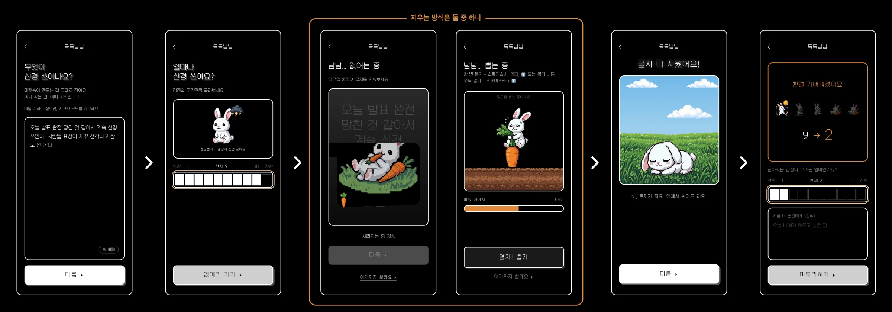
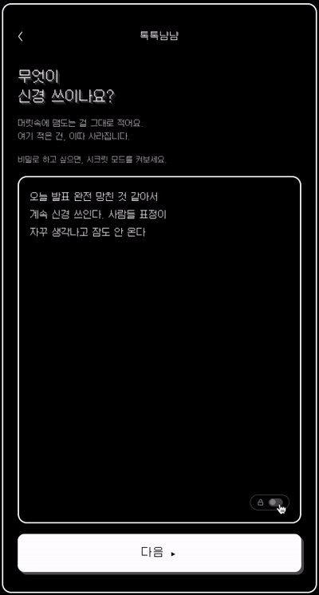
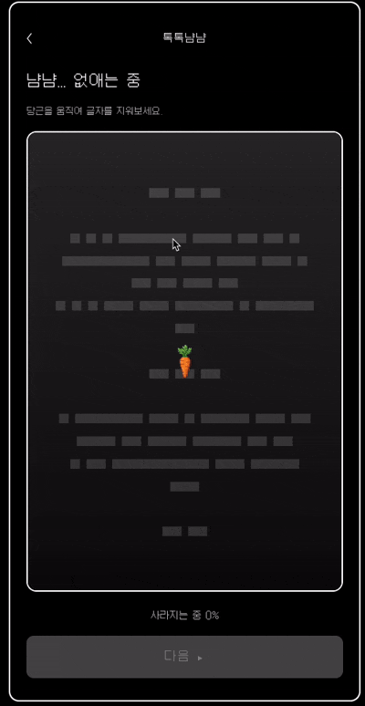
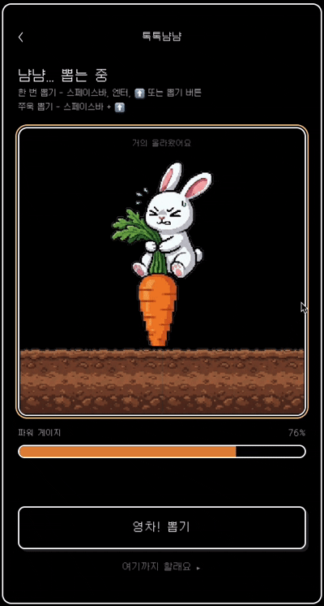

# 톡톡냠냠


<br/>

**쌓지 않고, 없애요** — 신경 쓰이는 걸 적고, 게임처럼 없애고, 가벼워져요
[지금 해보기 ▸](https://talktalk-naymnaym.vercel.app)

---

## 목차

- [서비스 설명](#서비스-설명)
- [기술 스택 &amp; 시작하기](#기술-스택--시작하기)
- [개발 기록](#개발-기록)

---

## 서비스 설명

### 톡톡냠냠의 시작

스트레스와 걱정, 마음속에 쌓이는 무거운 감정들
여러분은 이럴 때 어떻게 하시나요?

운동도, 취미도, 누군가에게 털어놓는 것도 어려운 순간이 있어요. 조용히, 아무도 모르게 감정을 흘려보낼 수 있다면 어떨까?
이 질문에서 톡톡냠냠이 시작됐어요.

### 톡톡냠냠의 방향

일상을 기록하고 분석해주는 서비스는 많아요. 톡톡냠냠은 달라요.
당 떨어질 때 먹는 간식처럼, 감정을 털어내고 싶을 때 부담 없이 들러서 해소하고 다시 일상으로 돌아갈 수 있는 서비스예요.

#### 🔒 완전한 비밀 보장

작성한 감정 기록은 서버, 브라우저 어디에도 남지 않아요.
시크릿 모드를 켜면 외부에 들키고 싶지 않은 이야기도 안심하고 적을 수 있어요.

#### 🥕 해결이 아닌 해소

톡톡냠냠은 감정을 분석하지 않아요.
분석의 무게까지 느끼고 싶지 않을 때, 빠르게 털어내고 일상으로 돌아가고 싶을 때 써보세요.

### 어떻게 사용하나요

**적고 → 강도를 재고 → 당근으로 지우고 → 가벼워진다**

지우는 방식은 두 가지 중에서 골라요. 기분에 따라 바꿔 가며 써보세요.



#### "🤫 비밀 이야기는 시크릿 모드를 사용해보세요."



#### "🐰 감정 기록을 지우면 귀여운 토끼가 나타나요."



#### "🥕 당근 뽑기로도 지울 수 있어요."



#### "💤 다 지운 뒤에는 쉬어가요."

게임이 끝나면 낮잠 자는 토끼와 함께 잠깐 숨을 고르는 시간이 있어요. 마음이 가벼워졌다면 바로 넘어가고, 더 하고 싶다면 한 번 더 할 수 있어요.


#### "🚪 그만두고 싶으면 언제든지."

"여기까지 할래요"로 언제든 멈추고 지금 마음을 다시 재볼 수 있어요. 끝까지 하지 않아도 괜찮아요.

#### "♿ 누구나 쓸 수 있게."

마우스·터치·키보드로 모두 즐길 수 있고, 스크린리더가 화면 이동과 감정 강도, 진행 상황을 읽어줘요. 움직임을 줄이는 설정(reduced motion)도 지원해요.

---

## 기술 스택 &amp; 시작하기

### 기술 스택

| 분류     | 기술               |
| -------- | ------------------ |
| Frontend | React, TypeScript  |
| Build    | Vite               |
| Styling  | CSS Modules        |
| State    | Zustand            |
| Test     | Vitest, Playwright |
| Deploy   | Vercel             |

### 시작하기

```bash
pnpm install
pnpm dev
```

### 테스트

```bash
pnpm test        # 단위 테스트 (Vitest)
pnpm test:e2e    # E2E 테스트 (Playwright)
```

E2E를 처음 실행한다면 `pnpm exec playwright install`로 브라우저를 먼저 설치하세요.

---

## 개발 기록

- [개발 의사결정 아카이브](https://github.com/BadaHertz52/talktalk-naymnaym/wiki/개발-의사결정-아카이브) — 어떤 기준으로 판단했고, 그 판단에 AI를 언제·왜 썼는지
- [v2.0.0 업데이트 히스토리](https://github.com/BadaHertz52/talktalk-naymnaym/wiki/v2.0.0-업데이트-히스토리) — 게임 방식 2종(스크래치·당근 뽑기)과 휴식 버퍼
- [Releases](https://github.com/BadaHertz52/talktalk-naymnaym/releases)
